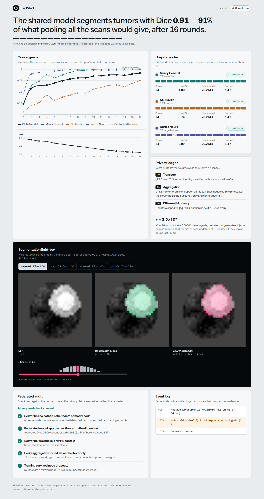

# FedMed

**Cross-silo federated learning for brain-tumor MRI segmentation, with encrypted aggregation.**

hree hospitals train one 3D U-Net together without ever sharing a scan. Model updates are
clipped and noised (differential privacy), encrypted on-site (CKKS homomorphic encryption) and
sent over gRPC/TLS. The aggregation server adds ciphertexts and cannot read anything it handles.
A React dashboard shows convergence, node health, the privacy budget, and tumor overlays.



## What you get

| | |
|---|---|
| **Federation** | [Flower](https://flower.ai) server + 3 hospital nodes, FedAvg (optional FedProx) over gRPC with TLS |
| **Model** | 3D U-Net (PyTorch) built for federation: InstanceNorm, so the model is exactly its parameters. MONAI U-Net optional |
| **Encryption** | [TenSEAL](https://github.com/OpenMined/TenSEAL) CKKS. The server holds a *public-only* key context and refuses to start with a secret key |
| **Differential privacy** | Per-update clipping + Gaussian noise with OS entropy, and a Rényi-DP accountant |
| **Resilience** | A hospital can crash mid-epoch; the round completes with the survivors and the node rejoins later |
| **Audit** | `fedmed audit` verifies convergence vs. a centralized baseline, ciphertext-only aggregation, public-only server keys, and that the server has no path to data or model code |
| **Dashboard** | Live over WebSocket, or replay of a bundled sample run. Convergence, nodes, privacy ledger, MRI light-box |
| **Data** | Offline synthetic 3D MRI with three deliberately different "scanners" (non-IID), or real BraTS |

## Quick start

```bash
python -m venv .venv && source .venv/bin/activate
pip install -e ".[dev,brats]"

make test                 # unit tests, seconds
make test-all             # + three end-to-end federations (TLS + CKKS, a node crash, plaintext mode), ~2.5 min

make chaos                # baseline -> 3-hospital federation -> export -> audit
                          # hospital 3 crashes in round 4 and rejoins; API stays up on :8000
make dashboard-install && make dashboard    # http://localhost:5173
```

The dashboard works with no backend running: it falls back to a bundled sample run and switches to
live data as soon as the API on `:8000` appears.

Run the pieces by hand (three terminals plus the API):

```bash
fedmed server                          # aggregation server  :8080 (TLS)
fedmed client --id 1                   # hospital nodes; status ports :8101 :8102 :8103
fedmed client --id 2
fedmed client --id 3
fedmed api                             # dashboard API       :8000
```

## Results

Reference run on the synthetic dataset (`configs/default.yaml`: 16 rounds, 2 local epochs, CKKS + DP + TLS,
hospital 3 crashing in round 4):

| Metric | Value |
|---|---|
| Centralized baseline (pooled data, reference only) | Dice 0.993 |
| **Federated global model, round 16** | **Dice 0.909** (IoU 0.868), 91.5% of baseline |
| Model size | 351,025 parameters |
| Encrypted update per hospital per round | 86 ciphertexts, 20.2 MB, ~1.4 s to encrypt |
| Server aggregation time per round | ~199 ms (ciphertext additions only) |
| Hospital 3 crash in round 4 | Round completed with 2 nodes; it rejoined for round 5 |
| Wall time, all 16 rounds | 5.2 min on one CPU core, all processes sharing it |
| Differential privacy | clip 8.0, noise multiplier 0.0005; ε ≈ 3.2e+07 at δ=1e-5, **demo-grade, not a formal guarantee** |

Per-hospital Dice on each node's own validation scans:

| Hospital | Dice |
|---|---|
| Mercy General | 1.000 |
| St. Aurelia | 0.742 |
| Nordic Neuro | 0.985 |

Reproduce with `make chaos`. Numbers vary slightly between runs because the DP noise is
deliberately not seeded.

Hospital 2 simulates an older 1.5T scanner with more noise and smaller lesions, so it learns more
slowly than the others. That is the non-IID problem federated learning actually has, not a bug.

## Week-by-week map

| Plan item | Where |
|---|---|
| Wk 1 centralized baseline | `fedmed baseline` (`fedmed/baseline.py`) |
| Wk 1 node scaffolding, 3 local ports | `fedmed/federated/client.py` + `status.py`: nodes on `:8101-8103` (training traffic goes to the server on `:8080`, see [architecture](docs/ARCHITECTURE.md)) |
| Wk 2 federated loop, FedAvg | `fedmed/federated/strategy.py` |
| Wk 2 gRPC + TLS | `fedmed/privacy/tls.py`, `fedmed gen-certs` |
| Mid-project: federated audit | `fedmed audit` (`fedmed/audit.py`) |
| Mid-project: node resilience | `fedmed federate --chaos 3:4`, `tests/test_federation_e2e.py` |
| Wk 3 homomorphic encryption | `fedmed/privacy/he.py` |
| Wk 3 live metrics over WebSocket | `fedmed/api.py` (`/ws`) |
| Wk 4 differential privacy | `fedmed/privacy/dp.py`, `scripts/privacy_sweep.py` |
| Wk 4 dashboard + segmentation masks | `dashboard/` |

## Using real BraTS data

```bash
pip install -e ".[brats]"
fedmed federate --config configs/default.yaml \
  --set data.source=brats --set data.brats_dir=/path/to/BraTS2021 \
  --set data.volume_size=64 --set data.n_channels=2
```

The loader (`fedmed/data/brats.py`) follows the documented BraTS 2021 folder layout and collapses
the labels to a whole-tumor mask. **It has not been run against the real dataset** (no access to it
where this was built), so expect to adjust file-name patterns. A 64³ crop makes each CKKS update several
times larger; raise `he.poly_modulus_degree` or shrink `model.base_filters` if payloads get heavy.

## Privacy: what is and is not guaranteed

Read [`docs/PRIVACY.md`](docs/PRIVACY.md) before using this near real patient data. In short:

* The server cannot decrypt, but all hospitals share **one** CKKS secret key (use threshold/multi-key HE in production).
* TLS authenticates the server, not the clients.
* With 3 silos and ~350k parameters, a *meaningful* differential-privacy ε costs most of the accuracy.
  The default noise keeps training working, which gives an ε far too large to call a guarantee. The
  dashboard labels it "demo-grade", and `make sweep` plots the real trade-off.

## Layout

```
fedmed/
  config.py            typed YAML config
  data/                synthetic MRI, BraTS loader, partitioning
  models/              3D U-Net, factory (MONAI optional)
  training/            losses, metrics, local train/eval
  privacy/             he.py (CKKS)  dp.py (clip+noise+accountant)  tls.py
  federated/           client, strategy, server, events, node status
  baseline.py  audit.py  export.py  api.py  cli.py
configs/               default.yaml, fast.yaml (seconds-scale smoke test)
scripts/               privacy_sweep.py, refresh_demo_data.sh
tests/                 unit tests + end-to-end federation tests
dashboard/             React + Vite + Recharts
docs/                  ARCHITECTURE.md, PRIVACY.md
```

## Verified, and not

Tested with Python 3.12, torch 2.14, flwr 1.40, tenseal 0.3.18, Node 22 (CPU only).

Verified: 17 unit tests; three end-to-end federations (TLS + CKKS aggregation, a hospital crashing
mid-round, and plaintext mode); the reference run and its audit; the dashboard production build and
its rendering in headless Chromium (desktop and phone widths).

Not verified: GPU training, the BraTS loader on real data, `model.name=monai_unet`, multi-machine
deployment, and the dashboard in browsers other than headless Chromium.

## License

MIT
